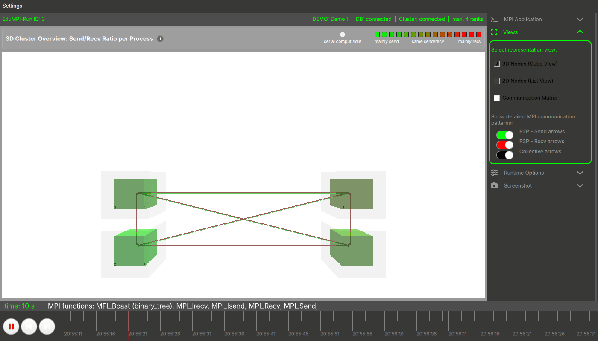
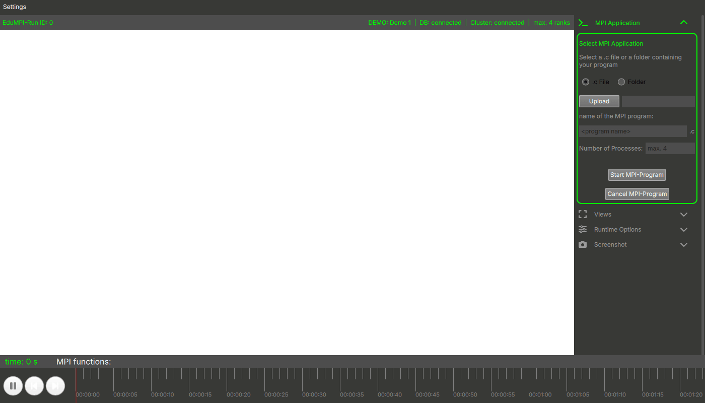
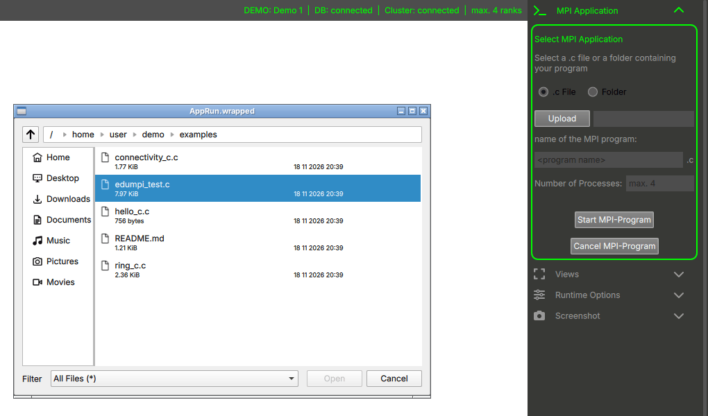
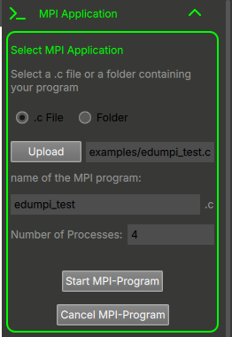
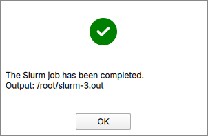
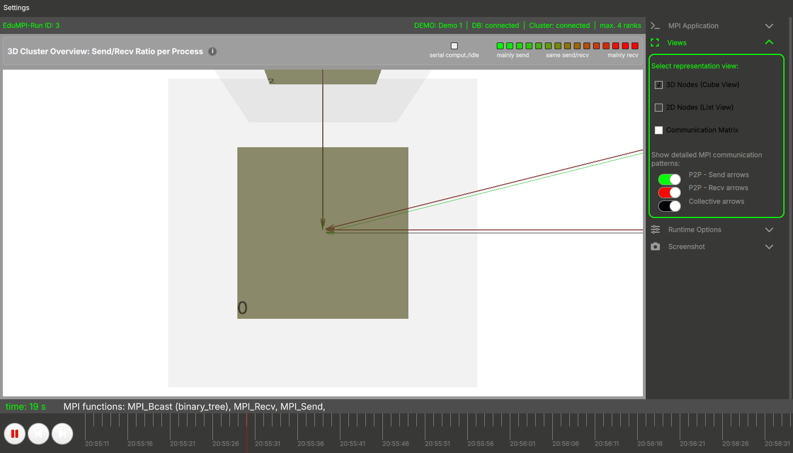
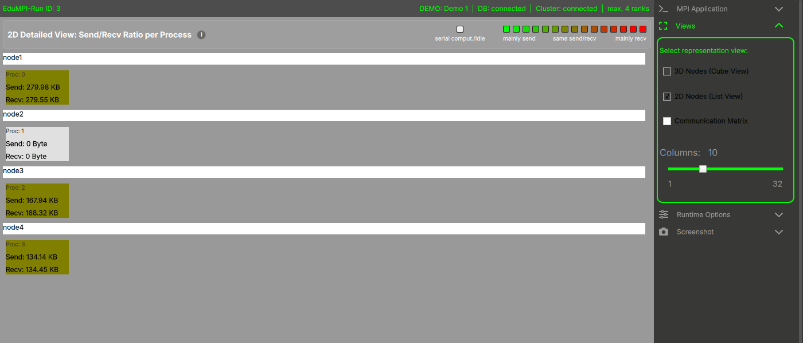
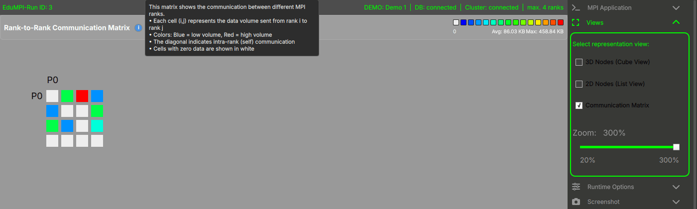
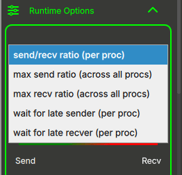
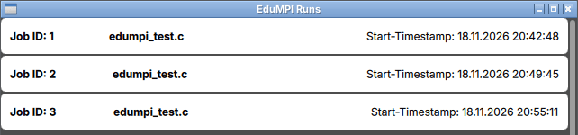

# EduMPI ausprobieren: Nutzer-Anleitung

Diese Anleitung zeigt, wie man EduMPI ohne eigenen Cluster auf dem eigenen Rechner ausprobiert und
wie man die EduMPI-Oberfläche bedient. Grundlage ist ein fertiges Demo-Paket
([EduMPI-Demo](https://github.com/Sithies/tool-edumpi-docker-private-test)): Ein Skript startet
lokal einen kleinen simulierten Cluster, eine Datenbank und die EduMPI-Oberfläche. Man braucht weder Cluster-Zugang noch MPI, Qt oder einen Build.

EduMPI macht sichtbar, wie die Prozesse eines MPI-Programms miteinander kommunizieren, live
während das Programm läuft.



**Inhalt:** [Voraussetzungen](#voraussetzungen) · [Installation](#installation) ·
[Starten](#starten) · [Erste Schritte in der GUI](#erste-schritte-in-der-gui) ·
[Eigene Programme](#eigene-mpi-programme-und-beispiele) · [Stoppen](#stoppen-und-aufräumen) ·
[Troubleshooting](#troubleshooting) · [Zugangsdaten](#zugangsdaten-der-demo)

## Voraussetzungen

| Was | Anforderung |
| --- | --- |
| Betriebssystem | macOS mit Apple Silicon, Windows x86_64 oder Linux x86_64 |
| Container-Engine | [**Docker**](https://docs.docker.com/get-docker/) (Desktop oder Engine ab 28) **oder** [**Podman**](https://podman.io/) (ab 4.3, mit `podman compose` bzw. `podman-compose`). Die Engine muss gestartet sein |
| Windows zusätzlich | [Git für Windows](https://git-scm.com/download/win) im Standardpfad `C:\Program Files\Git`. Die GUI nutzt dessen `bash` und `ssh` |
| Linux zusätzlich | `ssh` (Paket `openssh-client`) |
| Arbeitsspeicher | mindestens 4 GB frei für die Container-Engine; empfohlen ist ein Rechner mit 16 GB oder mehr |
| Speicherplatz | etwa 1,5 GB für die Images, dazu 350 bis 650 MB für den Ordner der Demo |
| Internet | nur beim ersten Start: Das Datenbank-Image `timescale/timescaledb` kommt von Docker Hub |

Je mehr Kerne und RAM die Engine hat, desto mehr MPI-Prozesse sind möglich (2 CPUs je Prozess).

## Installation

Entweder als ZIP herunterladen (auf der [Seite der Demo](https://github.com/Sithies/tool-edumpi-docker-private-test) **Code → Download ZIP**) und entpacken, oder
klonen:

```sh
git clone --depth 1 https://github.com/Sithies/tool-edumpi-docker-private-test.git
cd tool-edumpi-docker-private-test
```

Der Name des Repos kann sich noch ändern; dann die Adresse entsprechend anpassen. Alles Nötige
liegt im Ordner: Images, GUI für alle drei Systeme, Start- und Stopp-Skripte.

## Starten

| System | Befehl |
| --- | --- |
| macOS, Linux | `./start.sh` im Terminal, im entpackten bzw. geklonten Ordner |
| Windows | `start.cmd` in der Eingabeaufforderung oder Doppelklick (dann schließt sich das Fenster nach dem Start) |

Blockiert macOS das Skript nach einem ZIP-Download, einmal `xattr -dr com.apple.quarantine .` im
Ordner ausführen und erneut starten.

Das Skript zeigt zuerst, was es tun wird, und fragt nach. Mit `j` bestätigen:

```text
EduMPI-Demo "Demo 1" wird gestartet (linux/amd64, docker):
  • lädt Image  image/edumpi-node-amd64.tar.gz (74 MB) in docker
  • zieht       timescale/timescaledb:latest-pg17 von Docker Hub (falls nicht vorhanden)
  • startet     1× Datenbank (127.0.0.1:5432), 1× Login/SSH (127.0.0.1:2222),
                4× Node à 2 CPUs/3217 MB  → bis 4 MPI-Ranks
  • entpackt    gui/linux-x86_64.tar.gz nach .run/gui und startet die GUI im Demo-Modus
Alles bleibt in diesem Ordner. Beenden mit ./stop.sh, komplett entfernen mit ./stop.sh --purge
Fortfahren? [j/N] j
…
==> Cluster bereit: 4 Nodes idle, bis 4 Ranks
…
Fertig. Demo "Demo 1" läuft:
  Datenbank   127.0.0.1:5432   (edumpi/edumpi, DB edumpi)
  Cluster     ssh -p 2222 -i .run/ssh/demo_key dev@127.0.0.1   (sinfo, squeue)
  Beispiele   examples/        (edumpi_test.c zeigt alle Kommunikationsmuster)
  Beenden     ./stop.sh        Alles entfernen: ./stop.sh --purge
```

„bis N MPI-Ranks“ ist die Obergrenze für die Prozesszahl (ein Rank ist die Nummer eines
MPI-Prozesses, ab 0). Der erste Start dauert am längsten, weil das Datenbank-Image geladen wird.
Danach öffnet sich die GUI.

| Option (macOS, Linux) | Windows | Wirkung |
| --- | --- | --- |
| `-y` | `-Yes` | ohne Rückfrage starten |
| `--nodes 2` | `-Nodes 2` | Anzahl der Knoten festlegen (sonst automatisch nach Kernen und RAM der Engine, höchstens 4) |
| `--engine podman` | `-Engine podman` | Docker oder Podman erzwingen (sonst Docker, wenn es läuft) |
| `--no-gui` | `-NoGui` | nur Datenbank und Cluster starten |

## Erste Schritte in der GUI

Nach dem Start muss oben rechts in Grün stehen:
`DEMO: Demo 1 | DB: connected | Cluster: connected | max. N ranks`. Rechts liegen die Bereiche
*MPI Application*, *Views*, *Runtime Options* und *Screenshot*, unten die Zeitleiste.



### 1. Programm wählen und starten

Im Bereich **MPI Application**:

1. **Upload** klicken und eine `.c`-Datei wählen, zum Beispiel `examples/edumpi_test.c`.
2. **name of the MPI program**: Dateiname ohne `.c`. Das Feld wird beim Auswählen ausgefüllt.
3. **Number of Processes**: höchstens der Wert, der grau im Feld steht (`max. N`).
4. **Start MPI-Program** drücken. **Cancel MPI-Program** bricht einen laufenden Job ab.



| Formular ausgefüllt | Meldung am Ende des Laufs |
| --- | --- |
|  |  |

Das Programm läuft als Job im Cluster (verteilt von Slurm, einem üblichen Job-System für Cluster).
Nach wenigen Sekunden erscheinen die Prozesse, und die Zeitleiste unten zeigt die Laufzeit und die
gerade aufgerufenen MPI-Funktionen. Ist der Job fertig, meldet die GUI das. Die Ausgabe des
Programms (`printf`) liegt danach als `slurm-<Job-ID>.out` im eigenen Home-Verzeichnis.

### 2. Ansichten

Unter **Views** wählt man eine von drei Darstellungen. Das **i** neben dem Titel jeder Ansicht
erklärt Farben und Bedeutung.

**3D Nodes (Cube View)**, siehe Bild ganz oben: ein Würfel je Prozess, jeder Knoten in einem
eigenen Rahmen. Die Farbe zeigt das Verhältnis von Senden zu Empfangen (grün = überwiegend Senden,
rot = überwiegend Empfangen). Die Schalter *P2P - Send arrows*, *P2P - Recv arrows* und
*Collective arrows* blenden Pfeile zwischen den Prozessen ein. Ein Klick auf einen Würfel zoomt auf diesen
Knoten:



**2D Nodes (List View)**: Prozesse je Knoten mit gesendeter und empfangener Datenmenge. Der Regler
*Columns* legt fest, wie viele Prozesse nebeneinander stehen.



**Communication Matrix**: Zelle (i, j) zeigt, wie viele Daten Prozess i an Prozess j gesendet hat
(blau = wenig, rot = viel, weiß = nichts). Der Regler *Zoom* vergrößert die Matrix.



### 3. Runtime Options, Screenshot, gespeicherte Läufe

**Runtime Options** wirken auf die gewählte Ansicht:

| Einstellung | Bedeutung |
| --- | --- |
| Farbmodus (Auswahlliste) | Für 3D und 2D: *send/recv ratio*, *max send ratio*, *max recv ratio*, *wait for late sender*, *wait for late recver* (Wartezeit auf einen verspäteten Partner). Die Matrix kennt nur *heatmap - message volume* |
| Communication-Type | Kommunikationsarten einzeln ein- und ausblenden: *P2P* (Nachricht zwischen zwei Prozessen, z. B. `MPI_Send`/`MPI_Recv`), *Collective* (alle gemeinsam, z. B. `MPI_Bcast`), *One-Sided* (Speicherzugriff ohne Gegenstück) |
| Time display | Werte *per second* oder aufsummiert (*total data*) |



**Screenshot** speichert ein Bild des Fensters in `~/Pictures`.

Jeder Lauf bleibt in der Datenbank. Über **Settings → Load EduMPI-Run from DB** wählt man einen
früheren Lauf aus (Job ID = Nummer des Laufs); **Select EduMPI-Run** öffnet ihn in einem eigenen
Fenster.



## Eigene MPI-Programme und Beispiele

In `examples/` (im Ordner der Demo) liegen vier C-Programme zum Ausprobieren:

| Datei | Was man sieht |
| --- | --- |
| `edumpi_test.c` | Wechselt alle 5 s das Kommunikationsmuster (Ring, Verschiebung, Hotspot, Zufallspaare, Kollektive, Ungleichgewicht), läuft 60 s. Zeigt am meisten |
| `ring_c.c` | Eine Nachricht wandert zehnmal durch alle Prozesse. Kurz und übersichtlich |
| `connectivity_c.c` | Jeder Prozess tauscht einmal mit jedem anderen eine Nachricht aus |
| `hello_c.c` | Jeder Prozess meldet sich einmal. Fast keine Kommunikation, gut um den Ablauf zu sehen |

Eigene Programme wählt man genauso über **Upload**. Sie müssen `MPI_Init` aufrufen, nicht
`MPI_Init_thread`, sonst zeichnet EduMPI nichts auf.

## Stoppen und Aufräumen

| macOS, Linux | Windows | Wirkung |
| --- | --- | --- |
| `./stop.sh` | `stop.cmd` | Container entfernen. Die Daten bleiben, der nächste Start macht dort weiter |
| `./stop.sh --purge` | `stop.cmd -Purge` | zusätzlich Daten (Volumes), das geladene Image der Knoten und `.run/` löschen. Fragt vorher, außer mit `-y` bzw. `-Yes` |

Die GUI schließt man wie jedes Fenster. Laufzeitdaten liegen im Ordner der Demo (`.run/`).
Außerhalb davon landen nur die Images und drei Volumes in der Container-Engine sowie die
`slurm-*.out`-Dateien und Screenshots im Home-Verzeichnis. Das Datenbank-Image bleibt auch nach
`--purge` und lässt sich mit `docker rmi timescale/timescaledb:latest-pg17` (bzw. `podman rmi`)
entfernen.

## Troubleshooting

| Problem | Was tun |
| --- | --- |
| „Docker-Daemon läuft nicht“ bzw. „Docker läuft nicht“ | Docker Desktop starten, unter Linux `sudo systemctl start docker`. Podman auf macOS und Windows: `podman machine start` |
| Port belegt | Das Skript nimmt automatisch den nächsten freien Port und meldet ihn. Wunschport setzen: erst `./stop.sh`, dann `EDUMPI_DB_PORT=5433 ./start.sh`; unter Windows in der Eingabeaufforderung `stop.cmd`, `set EDUMPI_DB_PORT=5433`, `start.cmd`. Für SSH entsprechend `EDUMPI_SSH_PORT` |
| GUI bleibt bei „Cluster: connecting …“ | Linux: `ssh` installieren (`openssh-client`). Windows: Git für Windows nach `C:\Program Files\Git` installieren. Danach `./start.sh` bzw. `start.cmd` erneut ausführen |
| macOS: „App ist beschädigt“ oder Gatekeeper-Warnung | Die App ist nicht signiert. `start.sh` entfernt das Quarantäne-Attribut der GUI; kommt trotzdem eine Meldung: Systemeinstellungen → Datenschutz & Sicherheit → „Dennoch öffnen“ |
| Windows: PowerShell-Skripte sind deaktiviert | `start.cmd` benutzen, nicht `start.ps1` |
| Linux: GUI startet nicht | Ausgabe der GUI in `.run/gui.log` ansehen. Manuell starten: `EDUMPI_DEMO_ENV="$PWD/.run/demo.env" .run/gui/*.AppImage --appimage-extract-and-run` |
| Job bleibt PENDING | Mehr Prozesse angefordert, als der Cluster hat. Weniger Prozesse wählen |
| Wenig RAM oder wenig Kerne | `./start.sh --nodes 1` oder `--nodes 2` |
| Nichts hilft | `./stop.sh --purge`, dann `./start.sh` |

Logs der Container: `docker compose --env-file .env.demo -f compose.yml -f .run/nodes.yml logs`
(bei Podman `podman compose`).

## Zugangsdaten der Demo

Alle Werte sind öffentlich und gelten nur für diesen lokalen Cluster. Alle Ports hören nur auf
`127.0.0.1`.

| Dienst | Zugang |
| --- | --- |
| Cluster | `ssh -p 2222 -i .run/ssh/demo_key dev@127.0.0.1`, dort `sinfo` und `squeue`. EduMPI unter `/opt/edumpi`, Partition `all` |
| Datenbank | `127.0.0.1:5432`, Datenbank, Benutzer und Passwort jeweils `edumpi` |

## Welcher Stand steckt drin

[`demo.lock`](https://github.com/Sithies/tool-edumpi-docker-private-test/blob/demo-release/demo.lock) nennt den Namen der Demo, die Commits von EduMPI und GUI sowie die
Prüfsummen von Images und GUI-Archiven. Das Startskript prüft die Dateien der eigenen Plattform
dagegen, bevor es sie verwendet. Es gibt keine Versionsnummern: Jede neue Demo ersetzt die alte
komplett.

## Quellcode und Build

Das Demo-Paket baut EduMPI und die GUI aus Quellcode; welcher Stand genau, steht in `demo.lock`.
Build-Skripte und technische Doku der Demo liegen im Branch
[`master`](https://github.com/Sithies/tool-edumpi-docker-private-test/tree/master) des Demo-Repos.
Die Projekte selbst:
[EduMPI](https://github.com/AnnaLena77/EduMPI),
[EduMPI_measurement](https://github.com/AnnaLena77/EduMPI_measurement) und
[EduMPI_GUI](https://github.com/AnnaLena77/EduMPI_GUI).
